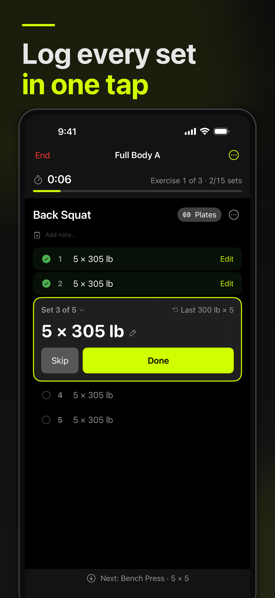
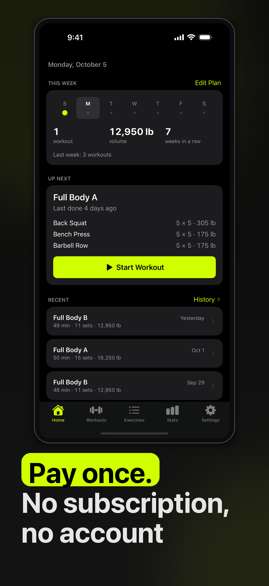

<picture>
  <source media="(prefers-color-scheme: dark)" srcset="Iron%20Workout/Assets.xcassets/AppIcon.appiconset/app-icon-dark.png">
  
</picture>

# Anvil Workout

Strength Programs & Tracker

<!-- IAMJARL README store block for Anvil Workout (en). Generated from apps.json, v1.34.0. Do not edit. -->
<p>
  <a href="https://apps.apple.com/app/id6760627760?pt=128512007&amp;ct=github&amp;mt=8"><picture>
    <source media="(prefers-color-scheme: dark)" srcset="https://raw.githubusercontent.com/JarlLyng/iamjarl-design/v1.34.0/badges/app-store-white-en-us.svg">
    
  </picture></a>
  <br>
  $2.99 once · iOS 17 or later · <a href="https://anvilworkout.iamjarl.com">anvilworkout.iamjarl.com</a>
</p>

<p>
  
  
</p>

Plan a program or start from a classic in the built-in library, then follow it set by set in the gym with a rest timer, on your iPhone and on your Apple Watch. Tap Done on each set, and the finished workout goes to your history and, if you allow it, to Apple Health. Your programs and workouts stay on your device, with no account. One purchase covers iPhone, iPad and Apple Watch, with no subscription and no ads.

## For developers

<p>
  <a href="https://madebyhuman.iamjarl.com"><picture>
    <source media="(prefers-color-scheme: dark)" srcset="https://madebyhuman.iamjarl.com/badges/co-created-white.svg">
    </picture></a>
  <a href="LICENSE"></a>
</p>

The developer half: what the app is built with, how to build and run it, how it is put together, how to contribute, and the license.

### Technology

| Area | Technology |
|------|-----------|
| UI | SwiftUI, Swift Charts |
| Persistence | SwiftData, on the device |
| Health | HealthKit |
| Widgets | WidgetKit, and ActivityKit for the Live Activity |
| Watch | watchOS app over WatchConnectivity |
| Monitoring | Sentry (sentry-cocoa) |
| Design system | [IAMJARL Design Tokens](https://github.com/JarlLyng/iamjarl-design) |
| Icons | [Phosphor Icons](https://github.com/phosphor-icons/swift) |
| Tests | Swift Testing |
| Language | Swift, in the Swift 5 language mode; English UI |

There is no backend and no login. The app talks to Apple Health on the device and, unless crash reporting is turned off in Settings, sends crash and error reports to Sentry.

### Build and run

```bash
git clone https://github.com/JarlLyng/Anvil-Workout.git
cd Anvil-Workout
open "Iron Workout.xcodeproj"
```

Pick the scheme **Iron Workout** and a simulator, then run with `⌘R`. The project, scheme and targets still carry the app's former name, Iron Workout (#83); the app itself is Anvil Workout.

- **No setup needed.** The app runs without extra configuration and seeds the exercise library on first launch. Sentry is optional and the build works without a DSN. HealthKit needs a physical device. The full setup, with Sentry, HealthKit, App Groups and the widgets, is in [docs/dev/SETUP.md](docs/dev/SETUP.md).
- **Tests:** run the whole `Iron WorkoutTests` target. A scoped `-only-testing` run can match nothing and pass anyway.
- **Release builds:** Release turns on `SWIFT_DEFAULT_ACTOR_ISOLATION = MainActor`, which catches isolation errors Debug doesn't, so build Release before calling anything ready.
- **Releasing:** Xcode Cloud builds when the `release` branch moves; pushes to `main` never build the app. The checklist is [docs/dev/RELEASE.md](docs/dev/RELEASE.md).

### Architecture

The app lives in `Iron Workout/`, with one folder per feature under `Features/` (Dashboard, Workouts, Exercises, History, Stats, Settings, Onboarding, Health) and shared models and services under `Shared/`. There are no view models: logic sits in services or in the views.

- **Iron Workout:** the iPhone and iPad app.
- **IronWorkoutWidgetExtension:** the home-screen widget and the Live Activity. It opens the app's SwiftData store read-only.
- **Anvil Watch Watch App** and **Anvil Watch WidgetExtension:** the watch app, which follows and controls a workout started on the iPhone, and its Smart Stack widget.

The file tree and data model are in [docs/dev/ARCHITECTURE.md](docs/dev/ARCHITECTURE.md), and the icon and colour rules in [docs/dev/DESIGN.md](docs/dev/DESIGN.md).

**The website** is static HTML in `docs/`, served by GitHub Pages at [anvilworkout.iamjarl.com](https://anvilworkout.iamjarl.com). [`pages.yml`](.github/workflows/pages.yml) deploys it on every push to `main` that touches `docs/`, so a change there is live at once.

### Contributing

Read [CONTRIBUTING.md](CONTRIBUTING.md) first. Bugs, feature requests and tasks are [GitHub Issues](https://github.com/JarlLyng/Anvil-Workout/issues) on this repo. Security issues go through [SECURITY.md](SECURITY.md), and the [Code of Conduct](CODE_OF_CONDUCT.md) applies. Code patterns are in [docs/dev/CONTRIBUTING.md](docs/dev/CONTRIBUTING.md).

| File | What it covers |
|------|----------------|
| [docs/dev/SETUP.md](docs/dev/SETUP.md) | Requirements, installation, Sentry, HealthKit, App Groups, widgets |
| [docs/dev/ARCHITECTURE.md](docs/dev/ARCHITECTURE.md) | Project structure, data model, relationships, user flow |
| [docs/dev/DESIGN.md](docs/dev/DESIGN.md) | Design tokens, Phosphor icons, colours, UI guidelines |
| [docs/dev/CONTRIBUTING.md](docs/dev/CONTRIBUTING.md) | Code style, adding features, tests |
| [docs/dev/RELEASE.md](docs/dev/RELEASE.md) | The release checklist |
| [docs/dev/PROGRAM_LIBRARY_SPEC.md](docs/dev/PROGRAM_LIBRARY_SPEC.md) | The bundled program library |
| [appstore/README.md](appstore/README.md) | The App Store screenshots and how they are captured |
| [CHANGELOG.md](CHANGELOG.md) | What changed in each version, newest first |

### License

[MIT](LICENSE). It covers the code, not the Anvil Workout name, brand or App Store listing. Anvil Workout is made by Jarl at [IAMJARL](https://iamjarl.com).
